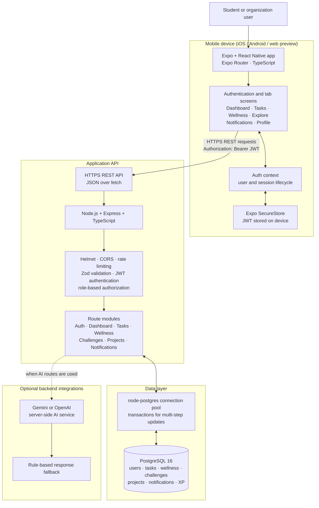

# SynergySphere Mobile App — Architecture Design

## High-level architecture

## Communication and technology decisions

| Connection | Mechanism | Design decision |
| --- | --- | --- |
| User → mobile app | Expo / React Native UI | A single TypeScript codebase targets Android and iOS; Expo Router provides file-based navigation. |
| Mobile app → API | `fetch`, HTTPS, JSON REST | The app sends the JWT as a Bearer token. The API base URL is supplied through `EXPO_PUBLIC_API_URL`, so no endpoint is hard-coded in the app binary. |
| Mobile session → device storage | Expo SecureStore | The token is kept in encrypted platform storage on native devices and is removed on sign-out. |
| API → PostgreSQL | `pg` connection pool and parameterized SQL | PostgreSQL is the system of record. Pool sizing, connection timeout, and transactions are configured in the backend. |
| API → AI provider (optional) | Server-side HTTPS | Provider keys remain on the server. Gemini is attempted first, then OpenAI; a local fallback preserves core responses if neither is configured. |

## Infrastructure considerations

- Deploy the Express API behind TLS and set `EXPO_PUBLIC_API_URL` to its HTTPS base URL. Do not expose database or AI-provider credentials to the mobile client.
- Run PostgreSQL as a managed production service or use the supplied Docker Compose PostgreSQL 16 service for local development. Back up the database and keep its persistent volume outside ephemeral application containers.
- Set a strong `JWT_SECRET`, production CORS allow-list, and production database URL through environment variables. JWTs expire after seven days in the current implementation.
- Keep the existing Helmet headers, request-size limit, Zod input validation, authentication middleware, role checks, and separate general/auth rate limits at the API boundary.
- Scale the API horizontally behind a load balancer when demand grows; the mobile client is stateless because the bearer token is held on the device and shared state is persisted in PostgreSQL.
- Monitor API health through `/api/health`, database connectivity, authentication failures, and rate-limit events. Centralized logs and alerts should be added at deployment time.
