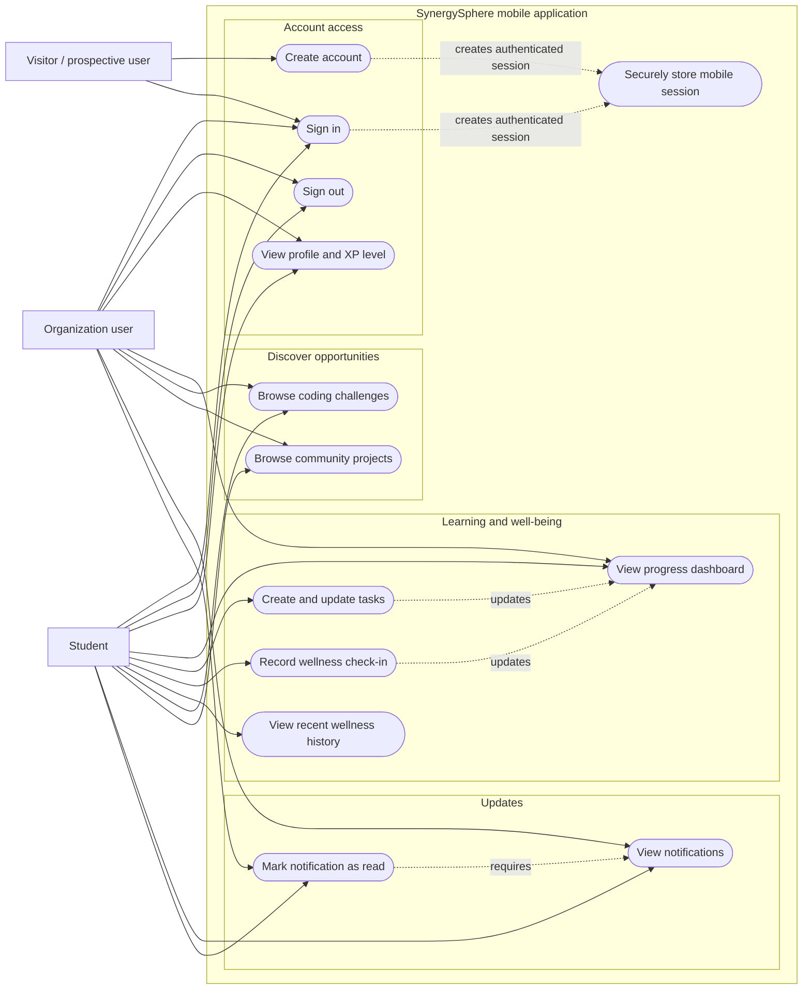

# SynergySphere Mobile App — Use-Case Diagram

This diagram represents the capabilities available through the Expo mobile application. It intentionally excludes web-only administration, AI, interview, portfolio, and lecture-material workflows.

## Actor scope

| Actor | Mobile-app interaction |
| --- | --- |
| Visitor / prospective user | Creates an account or signs in. |
| Student | Uses the full implemented mobile learning, productivity, wellness, discovery, notification, and profile experience. |
| Organization user | Can authenticate and use the role-neutral mobile dashboard, discovery, notification, and profile flows. There is no organization-management screen in the current mobile client. |

Administrators are not shown because the current mobile application contains no administrator workflow; administration is handled outside the mobile scope.
