# SynergySphere Use Case Diagram

The following diagram summarizes the primary actors and core use cases supported by the SynergySphere platform.

```mermaid
flowchart TB
    Visitor([Visitor])
    Student([Student])
    Organization([Organization])
    Admin([Admin])

    subgraph System[SynergySphere Platform]
        subgraph Access[Access & Account]
            UC1[Register account]
            UC2[Log in / log out]
            UC3[View landing dashboard]
        end

        subgraph Learning[Learning & Productivity]
            UC4[View personalized dashboard]
            UC5[Manage tasks and productivity goals]
            UC6[Track wellness and well-being]
            UC7[Use AI assistant for study support]
            UC8[Generate lecture-to-life learning materials]
            UC9[Attempt coding challenges and projects]
            UC10[View leaderboard and XP progress]
        end

        subgraph Career[Career & Community]
            UC11[Join community impact projects]
            UC12[Create and manage portfolio items]
            UC13[Practice mock interviews]
            UC14[Receive and mark notifications as read]
        end

        subgraph AdminArea[Administration]
            UC15[View admin analytics dashboard]
            UC16[Monitor platform activity and user progress]
            UC17[Manage community projects and platform content]
        end
    end

    Visitor --> UC1
    Visitor --> UC2
    Visitor --> UC3

    Student --> UC4
    Student --> UC5
    Student --> UC6
    Student --> UC7
    Student --> UC8
    Student --> UC9
    Student --> UC10
    Student --> UC11
    Student --> UC12
    Student --> UC13
    Student --> UC14

    Organization --> UC11
    Organization --> UC17

    Admin --> UC15
    Admin --> UC16
    Admin --> UC17
```

## Notes

- The diagram focuses on the main workflows currently represented by the application routes and pages.
- Students are the primary users for learning, wellness, coding, interviews, and portfolio activities.
- Organizations mainly engage with community and project-related workflows.
- Administrators oversee analytics, platform monitoring, and content management.
